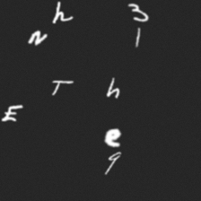
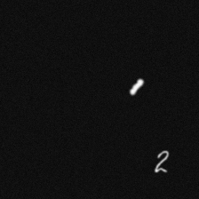
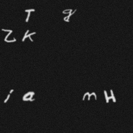
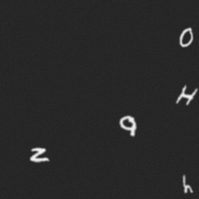
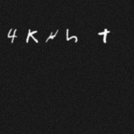
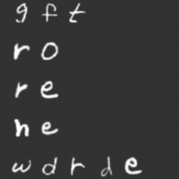
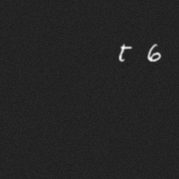
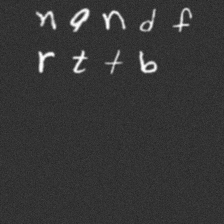

# Object Detection from Scratch (PyTorch)

Multi-object detection and character recognition implemented in PyTorch without a third-party detection framework. Given a 224×224 grayscale canvas containing multiple EMNIST characters, the models predict bounding boxes, confidence scores, and 47 character classes.

Trained on a custom synthetic dataset generated from EMNIST and benchmarked on an **RTX 5070 Ti**. The project includes two-stage, grid, anchor-based, anchor-free, auxiliary-supervised, and NMS-free detectors. See [BENCHMARK.md](./BENCHMARK.md) for the complete measured comparison.

---

## 🏛️ Pipeline Evolution & Architecture

The project evolved through multiple major architectural stages:

1. **Stage 4: Two-Stage Pipeline** — Separate ResNet detector predicting bounding boxes followed by crop-slicing and passing to an independent 47-class character classifier.
2. **Stage 5: Single-Stage Unified Detector (FC Tri-Head)** — Integrated bounding box regression, objectness scoring, and class recognition into a single network with global average pooling and Hungarian (bipartite) matching.
3. **Stage 6: Grid-Based Spatial ResNet Detector (YOLO-style)** — Fully convolutional detector operating directly on a $14 \times 14$ spatial feature grid with Focal Loss / BCE objectness, eliminating global pooling and FC projection overhead.
4. **Stage 7: Multi-Anchor ($K=3$) Spatial ResNet** — Tested multiple box priors per location. These checkpoints did not resolve the structured-layout recall failure; the results do not establish that anchors fail in general.
5. **Stage 8: FCOS Anchor-Free ResNet** — Two feature levels at $28 \times 28$ and $14 \times 14$, center-sampled LTRB regression targets, and a centerness head to rank box quality.
6. **YOLOv8-Inspired Anchor-Free Detector** — C2f/SPPF/PAN architecture with separate class and direct LTRB regression heads at the same two scales; no predefined anchors or objectness branch.
7. **Auxiliary YOLOv8** — Shared backbone with independent main and smaller auxiliary necks/heads. Training uses `L_main + 0.5 * L_aux`; inference retains only the main network and uses NMS.
8. **YOLOv10-Style NMS-Free Detector** — Prediction-aware top-1 assignment for the main branch and top-10 for the auxiliary branch. Inference uses the 1:1 head with confidence filtering and score top-k, without NMS.

### YOLOv10-Style Training and Inference

```
                      224×224 grayscale image
                                │
                     Shared C2f/SPPF backbone
                                │
              ┌─────────────────┴─────────────────┐
              │                                   │
      Detached features                    Shared features
              │                                   │
       Main neck + heads               Auxiliary neck + heads
       1:1 assignment                  1:many assignment
       28×28 and 14×14                  28×28 and 14×14
              │                                   │
              └────── L_main + 0.5 × L_aux ────────┘

      Inference: shared backbone → main neck + 1:1 heads
                 → confidence filter → score top-k → detections
```

The auxiliary neck uses half width and rounded half depth, with at least one block. Its loss trains the shared backbone; the main branch trains its own neck and heads from detached backbone features. `YOLOv10Loss` is integrated in [`training/losses.py`](./training/losses.py).

This implementation adopts YOLOv10-style dual assignment on the existing architecture. It uses direct LTRB regression and does not implement the full published YOLOv10 CIB/PSA architecture or distributional regression.

During training, auxiliary models return nested `{"main": ..., "aux": ...}` predictions. In evaluation mode they return main predictions only. `model.to_inference()` removes the auxiliary parameters; YOLOv10-style exports retain their NMS-free behavior and reload with `build_model("yolov10", size=..., inference_only=True)`.

### Current Benchmark Snapshot

Average end-to-end F1 across 10,000 images in four layouts (`random`, `grid`, `words`, `line`):

| Detector family | Nano | Small | Medium | Inference post-processing |
|:---|:---:|:---:|:---:|:---|
| FCOS | 0.9048 | 0.9030 | 0.9015 | Centerness-gated scores + class-wise NMS |
| YOLOv8-inspired | 0.9087 | 0.9061 | 0.8990 | Class scores + class-wise NMS |
| Auxiliary YOLOv8 | 0.9071 | 0.9065 | Not trained | Main-only class scores + class-wise NMS |
| YOLOv10-style | 0.9101 | 0.9045 | 0.8949 | Main-only class scores + score top-k; no NMS |

YOLOv10-style results are **provisional**: its held-out E2E sweep covered confidence 0.20–0.80 and excluded 0.10. The notebook selected 0.10 for detection-only F1 on its own split. An expanded lower-threshold comparison of detection F1 and E2E F1 remains pending. YOLOv8 Medium uses the test-sweep threshold override documented in its report; the other rows use held-out E2E tuning.

Nano has the highest recorded E2E F1 among the YOLOv10-style sizes and runs at 10,176 img/s in the model-only float32, batch-128 measurement. Its 0.14 percentage point E2E difference from YOLOv8 Nano does not establish a reliable accuracy improvement from single runs. Model-only throughput excludes decoding and post-processing, so it does not measure savings from removing NMS.

---

## ⚡ Model Parameter Audit & Size Scaling

The two-scale detectors use strides 8 and 16. Deployment parameter counts are:

| Detector family | Nano | Small | Medium |
|:---|---:|---:|---:|
| FCOS | 0.52M | 1.79M | 7.14M |
| YOLOv8-inspired | 0.83M | 2.51M | 6.47M |
| Auxiliary YOLOv8, main-only export | 0.83M | 2.51M | Not benchmarked |
| YOLOv10-style, main-only export | 0.83M | 2.51M | 6.47M |

YOLOv10-style training includes the auxiliary branch: 1.08M / 3.13M / 7.54M parameters for Nano / Small / Medium. All four families return per-scale class logits and LTRB distances; FCOS also returns centerness logits. Historical grid shapes, parameter counts and threshold audits are in the [grid benchmark report](./benchmark/03_grid_based_spatial_resnet.md).

---

## 🔬 Key Architectural Discoveries

### 1. Spatial Heads Improved the Early Small Models

The early unified Nano model had 36.34% average conditional classification accuracy, versus 86.59% for the later grid BCE Nano checkpoint. This comparison motivated retaining spatial feature maps, but it is not an isolated ablation of pooling or head design.

### 2. Structured Layouts Exposed a Localization Failure

The historical single-scale grid models performed well on random placement but lost recall on `grid`, `words` and `line`. The benchmark metadata audit found no ground-truth centers sharing a 14×14 cell, so target overwriting does not explain those failures. Feature interference is a hypothesis, not a proven sole cause. Multiple anchors did not resolve the failure in the tested configurations; the later two-scale anchor-free models maintained much higher structured-layout recall.

### 3. Auxiliary Supervision Did Not Establish an E2E Gain

Auxiliary YOLOv8 Nano and Small achieved nearly identical benchmark E2E F1. Their differences from the YOLOv8 baseline were small, and Nano offered higher inference throughput. Medium training was deferred for that experiment; all three sizes were subsequently trained for the separate YOLOv10-style experiment.

### 4. More Recall Does Not Guarantee Better Recognition

YOLOv10-style recall increased with size, while E2E F1 decreased. Classification accuracy is conditional on each model's matched detections, so a larger model may be graded on harder objects that Nano misses. A comparison on common matched objects is needed before attributing the decline to weaker classification or overfitting.

Detection F1 scores localization alone; E2E F1 requires both localization and the correct character. The training notebook sweeps before final classification/E2E evaluation and logs both the sweep and final metrics. Its default detection-F1 selection differs from the benchmark's held-out E2E selection.

---

## 📊 Stage 1 -- Standalone Character Classifier

A lightweight **ResNet** backbone (370,351 parameters / **0.37M**) with a fully-connected classification head. Input: 28×28 grayscale crop. Output: probability distribution over 47 character classes (EMNIST ByMerge).

| Split | Val Accuracy |
|---|---|
| ByClass (62 classes) | ~86.0% |
| **ByMerge (47 classes)** | **~89.9%** |

---

## 🖼️ Dataset & Layout Placement Strategies

The synthetic dataset is generated from scratch using EMNIST characters composited onto blank 224×224 canvases. See [`generator/README.md`](generator/README.md) for full documentation on the generation pipeline, layout strategies, and metadata format.

**Generated dataset**: 255,000 training / 45,000 test images. The benchmark uses a separate placement-stratified set of 10,000 images plus a 500-image random-layout tuning split for confidence selection.

### Companion semantic segmentation project

[Semantic Segmentation from Scratch](https://github.com/Asmit-Kumar/semantic-segmentation-from-scratch) reuses these generated EMNIST scene images and their 47 character classes for pixel-level segmentation with a U-Net. It preserves the detection images and bounding-box annotations, deriving separate approximate masks with background ID 0 and character IDs 1–47 (detection label + 1).

For segmentation, follow the [dataset setup and mask construction guide](https://github.com/Asmit-Kumar/semantic-segmentation-from-scratch/blob/main/README.md#emnist-dataset-location) and the [EMNIST segmentation benchmark](https://github.com/Asmit-Kumar/semantic-segmentation-from-scratch/blob/main/benchmark/02_emnist.md). The source scenes are shared, while benchmark subsets and evaluation protocols are selected independently; detection F1 and segmentation mIoU are not directly comparable.

| Layout Strategy | Sample Scene 1 | Sample Scene 2 | Description |
|:---|:---:|:---:|:---|
| **🎲 Random** |  |  | Unconstrained random spatial locations across the 224×224 canvas. |
| **📐 Grid** |  |  | Structured rows and columns forming tabular or grid patterns. |
| **📝 Words** |  |  | Character sequences mimicking multi-character word groupings. |
| **📏 Line** |  |  | Single horizontal line text layout. |

---

## 📁 Repository & Benchmark Index

- **[`BENCHMARK.md`](./BENCHMARK.md)** — **Master Benchmark Hub & Cross-Stage Comparison**
- **[`benchmark/01_two_stage_resnet.md`](./benchmark/01_two_stage_resnet.md)** — **Stage 4 Two-Stage ResNet Detection Pipeline**
- **[`benchmark/02_single_stage_unified_resnet.md`](./benchmark/02_single_stage_unified_resnet.md)** — **Stage 5 Single-Stage Unified ResNet Detector**
- **[`benchmark/03_grid_based_spatial_resnet.md`](./benchmark/03_grid_based_spatial_resnet.md)** — **Stage 6 Grid-Based Spatial ResNet Detector (Focal & BCE)**
- **[`benchmark/04_multi_anchor_spatial_resnet.md`](./benchmark/04_multi_anchor_spatial_resnet.md)** — **Stage 7 Multi-Anchor Spatial ResNet (Retirement Report)**
- **[`benchmark/05_fcos_anchor_free_resnet.md`](./benchmark/05_fcos_anchor_free_resnet.md)** — **Stage 8 FCOS Anchor-Free ResNet Detector**
- **[`benchmark/06_yolov8_anchor_free_resnet.md`](./benchmark/06_yolov8_anchor_free_resnet.md)** — **YOLOv8-Inspired Anchor-Free Detector**
- **[`benchmark/07_auxiliary_yolov8_resnet.md`](./benchmark/07_auxiliary_yolov8_resnet.md)** — **Auxiliary YOLOv8, Main-Only Inference**
- **[`benchmark/08_yolov10_nms_free.md`](./benchmark/08_yolov10_nms_free.md)** — **YOLOv10-Style NMS-Free Detector**

### Code Layout

- **[`models/`](./models/)** — Architectures and size presets; `build_model(name, size)` / `load_model(name, path, device, size)` for `grid`, `multiscale`, `fcos`, `yolov8`, `auxiliary`, `yolov10` and `classifier`.
- **[`dataio/`](./dataio/)** — EMNIST reader, datasets and loaders, LTRB target encoding, and prediction-aware task-aligned assignment.
- **[`training/`](./training/)** — `fit()` and evaluation, losses, checkpointing, run logger.
- **[`inference/`](./inference/)** — `DetectionPipeline` and prediction decoding.
- **[`generator/`](./generator/)** — Synthetic multi-character canvas generation.
- **[`utils/`](./utils/)** — Visualizer, plus aliases so older `utils.<module>` imports keep working.
- **[`scripts/`](./scripts/)**, **[`notebooks/`](./notebooks/)**, **[`tests/`](./tests/)** — Benchmarks, training notebooks and the test suite.

Earlier stages are tagged (`stage4-two-stage` … `stage8-fcos`, and `v1-tensorflow` for the original TensorFlow version); check one out with `git switch --detach <tag>`.

---

## 🛠️ Setup & Execution

```bash
pip install -r requirements.txt
```

Run the tests (architecture signatures, checkpoint loading, import paths):
```bash
python -m unittest discover -s tests -t . -v
```

Train and evaluate the two-scale detectors in [`notebooks/detection.ipynb`](./notebooks/detection.ipynb). Select `MODEL_NAME` from `fcos`, `yolov8`, `auxiliary`, or `yolov10`; size presets are `n`, `s`, `m`, and `l`, though not every family/size has a trained checkpoint. Training uses `LTRBLoss` for the first three families and `YOLOv10Loss` for dual assignment.

Dataset files, `.pth` checkpoints, run logs and raw benchmark JSON caches are excluded from Git. Benchmarking requires the corresponding local datasets and trained weights. The [generator guide](./generator/README.md) covers dataset creation; the individual benchmark reports identify checkpoint names and reproduction commands.

The benchmark, density and visual scripts support `grid` (default), `fcos`, `yolov8`, `auxiliary`, and `yolov10`. For example:

```bash
# Grid-based benchmark (default)
python scripts/run_single_stage_benchmark.py
# FCOS benchmark
python scripts/run_single_stage_benchmark.py --detector fcos
# YOLOv8-inspired benchmark
python scripts/run_single_stage_benchmark.py --detector yolov8
# Auxiliary YOLOv8 benchmark (Nano and Small)
python scripts/run_single_stage_benchmark.py --detector auxiliary
```

Run the complete YOLOv10-style workflow in order. The preparation check copies best checkpoints into `weights/` and verifies exact main-only export and NMS-free decoding:

```bash
python scripts/check_yolov10_benchmark.py
python scripts/run_single_stage_benchmark.py --detector yolov10
python scripts/run_density_sweep.py --detector yolov10
python scripts/generate_single_stage_visuals.py --detector yolov10
python scripts/render_benchmark_reports.py --yolov10-only
python scripts/check_yolov10_benchmark.py --artifacts-only
```

For another family, use its detector name in the shared density and visual commands:

```bash
python scripts/run_density_sweep.py --detector fcos
python scripts/generate_single_stage_visuals.py --detector fcos
```

To regenerate the synthetic dataset from scratch:
```bash
python -c "from generator.generator import DatasetGenerator; DatasetGenerator().generate()"
```
