# Auxiliary YOLOv8 Nano and Small Benchmark

Benchmark of the completed auxiliary-supervised models, measured on 2026-10-17. The shared backbone and independent auxiliary neck/heads are used during training; only the main backbone, neck and heads remain for inference. Medium has not been trained or measured.

Evaluation follows the existing benchmark: 224 x 224 grayscale inputs in [0, 1], batch 128, all four placement layouts, class-wise NMS IoU 0.45 and Hungarian matching at IoU 0.50. Classification accuracy is conditional on correctly localized detections; E2E F1 requires both localization and the correct class. Results are unweighted means across layouts.

## Summary

<!-- BEGIN GENERATED: summary -->
| Architecture | Size | Params | `conf` | `conf` Source | Avg Det Precision | Avg Det Recall | Avg Classifier Acc | Avg End-to-End F1 | Eval-Loop Throughput | Pure Inference |
|:---|:---:|:---:|:---:|:---:|:---:|:---:|:---:|:---:|:---:|:---:|
| **Auxiliary YOLOv8** | Nano (`n`) | 0.83M | 0.40 | held-out tune set | 0.9867 | 0.9814 | 92.18% | 0.9071 | 507 img/s | 8,633 img/s |
| **Auxiliary YOLOv8** | Small (`s`) | 2.51M | 0.45 | held-out tune set | 0.9957 | 0.9586 | 92.81% | 0.9065 | 611 img/s | 4,415 img/s |
<!-- END GENERATED: summary -->

## Threshold Sweep Before Final Evaluation

<!-- BEGIN GENERATED: tuning -->
Confidence thresholds for Auxiliary YOLOv8 are tuned to maximize end-to-end F1 on a **held-out tuning set** (`data/OD_benchmark/tune/random`, 500 images from `scripts/generate_benchmark_dataset.py --tune-only`) that shares no images with the 10,000-image benchmark.

Selection sweeps confidence 0.20 through 0.80 in steps of 0.05 and uses E2E F1, including localization and class correctness. Ties choose the lower threshold. The complete sweep is saved in `auxiliary_results.json`; final test evaluation runs afterward. The notebook test-set Detection F1 threshold is a separate experiment.

| Size | Confidence | Held-out E2E F1 |
|:---|:---:|:---:|
| Nano | 0.40 | 0.898277 |
| Small | 0.45 | 0.893001 |
<!-- END GENERATED: tuning -->

## Checkpoint and Training Audit

<!-- BEGIN GENERATED: params -->
| Size | Training parameters | Main-only parameters | Best checkpoint | SHA-256 |
|:---|:---:|:---:|:---|:---|
| Nano | 1,084,096 | 831,608 | `weights\auxiliary_n_28x14_best.pth` | `8888c186e0f489e342f107074c6fe200af4a641a02762dabea3d97f448f1715b` |
| Small | 3,133,552 | 2,509,576 | `weights\auxiliary_s_28x14_best.pth` | `dbeceea616310a68f62854b6788ce5dbd19b0c6fbb687e12918ff7397b329fea` |

Both checkpoints load strictly. Before evaluation, `to_inference()` removes the auxiliary neck and heads. A CUDA smoke check verified identical predictions before and after removal for both sizes. The training branch uses 0.5x width, rounded half-depth (minimum one block), and loss weight 0.5.

This repository version uses direct four-distance LTRB regression in both model families; the comparison is against the existing repository YOLOv8-inspired checkpoints.

| Size | Completed epochs | Best validation epoch | Best validation E2E F1 | Training time | Log |
|:---|:---:|:---:|:---:|:---:|:---|
| Nano | 60 | 47 | 0.9006 | 193.1 min | `logs/AuxiliaryObjectDetector/auxiliary_n_28x14_20261017_071756.json` |
| Small | 60 | 57 | 0.9185 | 244.2 min | `logs/AuxiliaryObjectDetector/auxiliary_s_28x14_20261016_093424.json` |
<!-- END GENERATED: params -->

## Per-Layout Results

<!-- BEGIN GENERATED: results -->
### Auxiliary Nano

| Layout | Det Precision | Det Recall | Classifier Acc | End-to-End F1 | Eval-Loop Throughput |
|:---|:---:|:---:|:---:|:---:|:---:|
| 🎲 Random | 0.9882 | 0.9737 | 91.12% | 0.8938 | 513.3 img/s |
| 📐 Grid | 0.9873 | 0.9735 | 91.45% | 0.8965 | 514.3 img/s |
| 📝 Words | 0.9846 | 0.9891 | 93.15% | 0.9193 | 506.2 img/s |
| 📏 Line | 0.9867 | 0.9892 | 93.00% | 0.9188 | 493.4 img/s |
| **Average** | **0.9867** | **0.9814** | **92.18%** | **0.9071** | **506.8 img/s** |

Pure inference (`model(images)` only, batch 128): **8,633.3 img/s**.

### Auxiliary Small

| Layout | Det Precision | Det Recall | Classifier Acc | End-to-End F1 | Eval-Loop Throughput |
|:---|:---:|:---:|:---:|:---:|:---:|
| 🎲 Random | 0.9960 | 0.9401 | 92.73% | 0.8969 | 638.2 img/s |
| 📐 Grid | 0.9964 | 0.9419 | 93.05% | 0.9011 | 632.1 img/s |
| 📝 Words | 0.9951 | 0.9764 | 92.87% | 0.9154 | 602.5 img/s |
| 📏 Line | 0.9954 | 0.9758 | 92.59% | 0.9125 | 571.1 img/s |
| **Average** | **0.9957** | **0.9586** | **92.81%** | **0.9065** | **611.0 img/s** |

Pure inference (`model(images)` only, batch 128): **4,415.0 img/s**.
<!-- END GENERATED: results -->

## Throughput

<!-- BEGIN GENERATED: throughput -->
| Size | Median pure inference | Repeat range | Eval-loop average |
|:---|:---:|:---:|:---:|
| Nano | 8,633.3 img/s | 7,223.8–9,369.9 | 506.8 img/s |
| Small | 4,415.0 img/s | 3,836.3–4,435.4 | 611.0 img/s |

Measured on NVIDIA GeForce RTX 5070 Ti, PyTorch 2.11.0+cu130, float32, batch 128. Pure inference uses at least 2 seconds of warm-up, 11 repeats of 30 synchronized forward passes, and excludes decoding, NMS and matching.

_Eval-loop throughput is wall-clock over the whole evaluation loop (PNG decoding with `num_workers=0`, target encoding in the collate function, host↔device copies, post-processing and scipy Hungarian matching); it is dominated by that overhead and varies run to run, so it is not a model-speed comparison. Pure inference times only `model(images)` on GPU-resident batches of 128 (median of repeated, synchronized runs after a ≥2 s warm-up)._
<!-- END GENERATED: throughput -->

## Density-Stratified Recall

Density uses the existing score-ordered greedy matcher, while the main E2E table uses Hungarian matching. These follow the repository's separate evaluation protocols.

Buckets include images with 1–16 ground-truth objects; images outside that range remain in the main 10,000-image evaluation. Throughput repeat ranges are shown above because GPU timing varied during this session.

<!-- BEGIN GENERATED: density -->
### 🎲 Random Layout

| Density Bucket ($n_{gt}$) | Test Images | Auxiliary Nano | Auxiliary Small |
|:---:|:---:|:---:|:---:|
| **1 – 4 objects** | 236 | **97.5%** | 94.0% |
| **5 – 8 objects** | 1,244 | **97.0%** | 93.8% |
| **9 – 12 objects** | 850 | **97.5%** | 94.2% |
| **13 – 16 objects** | 170 | **97.9%** | 94.3% |

### 📐 Grid Layout

| Density Bucket ($n_{gt}$) | Test Images | Auxiliary Nano | Auxiliary Small |
|:---:|:---:|:---:|:---:|
| **1 – 4 objects** | 228 | **97.2%** | 93.6% |
| **5 – 8 objects** | 1,319 | **97.5%** | 94.3% |
| **9 – 12 objects** | 807 | **97.3%** | 94.1% |
| **13 – 16 objects** | 146 | **97.2%** | 94.1% |

### 📝 Words Layout

| Density Bucket ($n_{gt}$) | Test Images | Auxiliary Nano | Auxiliary Small |
|:---:|:---:|:---:|:---:|
| **1 – 4 objects** | 253 | **98.3%** | 97.0% |
| **5 – 8 objects** | 1,235 | **99.0%** | 97.9% |
| **9 – 12 objects** | 866 | **98.8%** | 97.5% |
| **13 – 16 objects** | 137 | **99.3%** | 97.5% |

### 📏 Line Layout

| Density Bucket ($n_{gt}$) | Test Images | Auxiliary Nano | Auxiliary Small |
|:---:|:---:|:---:|:---:|
| **1 – 4 objects** | 244 | **98.9%** | 97.4% |
| **5 – 8 objects** | 1,231 | **99.1%** | 97.6% |
| **9 – 12 objects** | 862 | **98.8%** | 97.5% |
| **13 – 16 objects** | 149 | **98.8%** | 98.0% |
<!-- END GENERATED: density -->

## Comparison and Medium Decision

<!-- BEGIN GENERATED: comparison -->
| Size | Existing YOLOv8 E2E F1 | Auxiliary E2E F1 | Change | Recall change | Classifier accuracy change |
|:---|:---:|:---:|:---:|:---:|:---:|
| Nano | 0.9087 | 0.9071 | -0.16 pp | +3.93 pp | -1.72 pp |
| Small | 0.9061 | 0.9065 | +0.04 pp | -0.28 pp | +0.11 pp |

Scaling Nano to Small changes average E2E F1 by -0.06 pp and recall by -2.28 pp. Small uses 3.02x the deployed parameters and runs at 0.51x Nano throughput.

These are single trained runs per size and historical baseline checkpoints, without repeated seeds or confidence intervals. They support a practical model choice, but do not isolate the causal effect of auxiliary supervision or predict the result of an untrained Medium model. Historical throughput was measured in a different session.
<!-- END GENERATED: comparison -->

Auxiliary supervision did not demonstrate a meaningful end-to-end accuracy improvement over the YOLOv8 baseline under the tested configurations. Nano and Small achieved nearly identical F1, while Nano offered substantially higher inference throughput. Further scaling to Medium was deferred because the available evidence did not justify the additional training cost.

## Visual Examples

Visuals use the same selected confidence and NMS settings as final evaluation.

<!-- BEGIN GENERATED: visuals -->
### Nano

| Random | Grid | Words | Line |
|:---:|:---:|:---:|:---:|
| 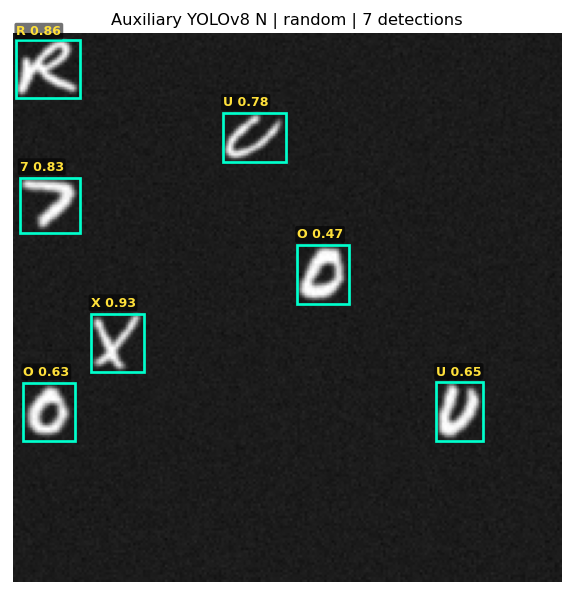 | 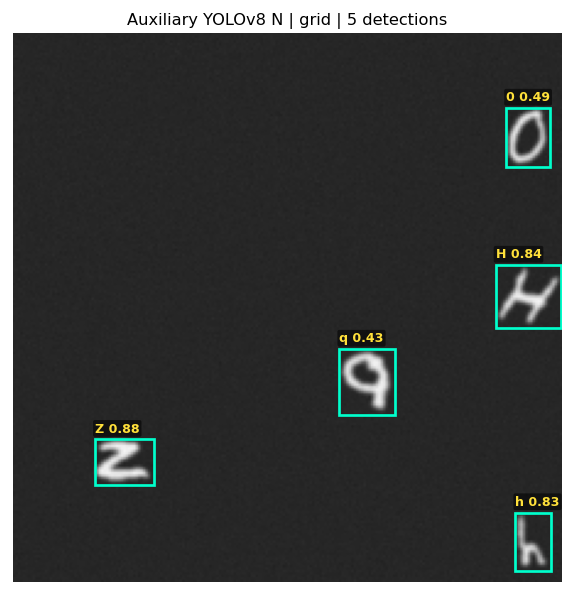 | 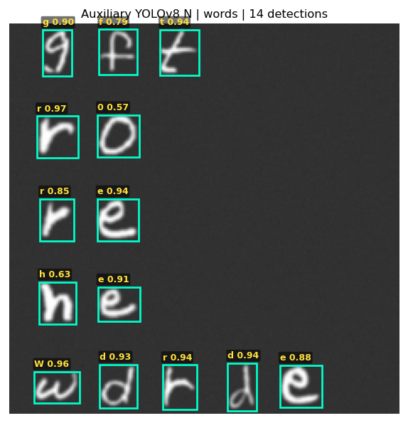 | 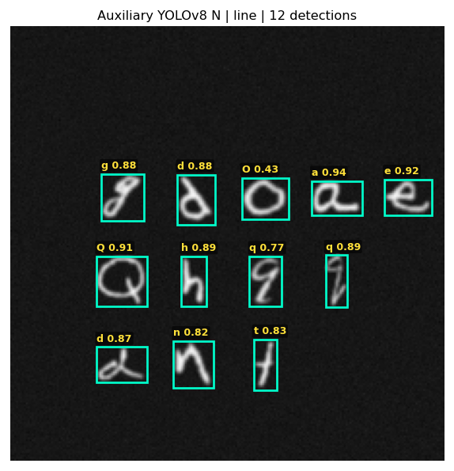 |
| 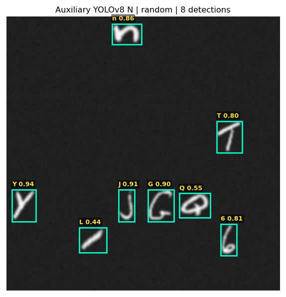 | 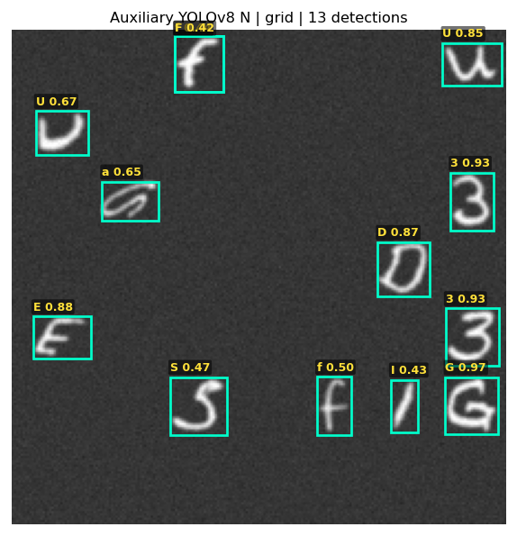 | 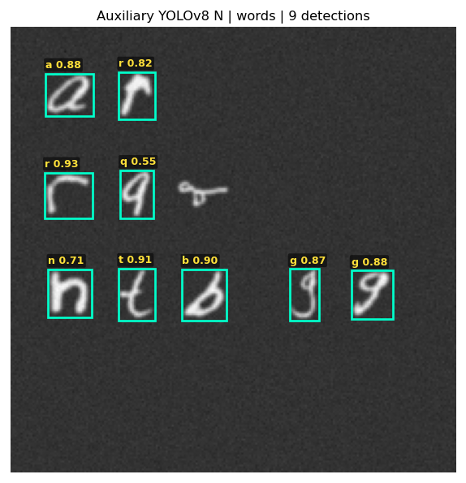 | 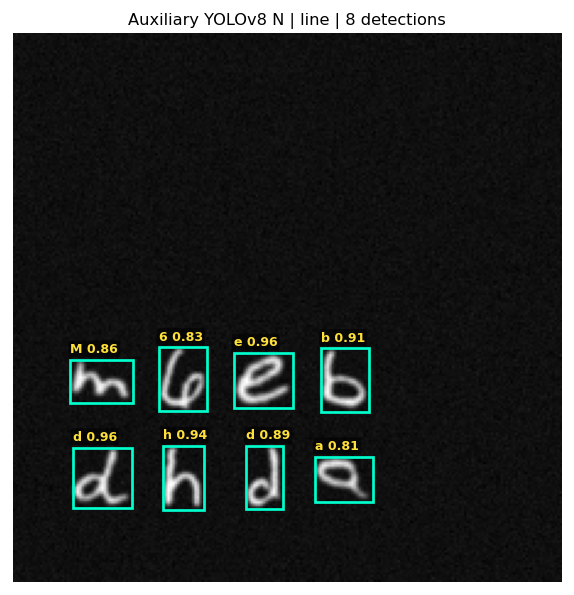 |

### Small

| Random | Grid | Words | Line |
|:---:|:---:|:---:|:---:|
| 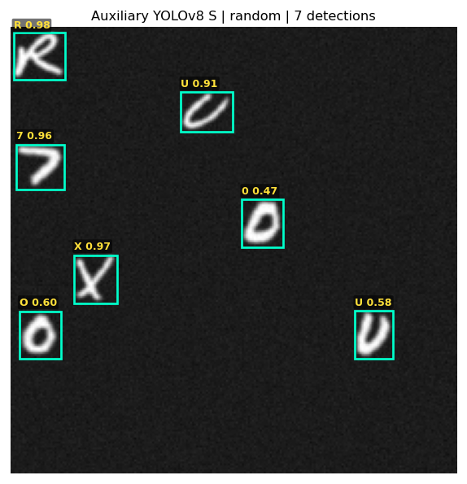 | 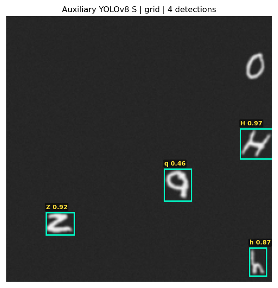 | 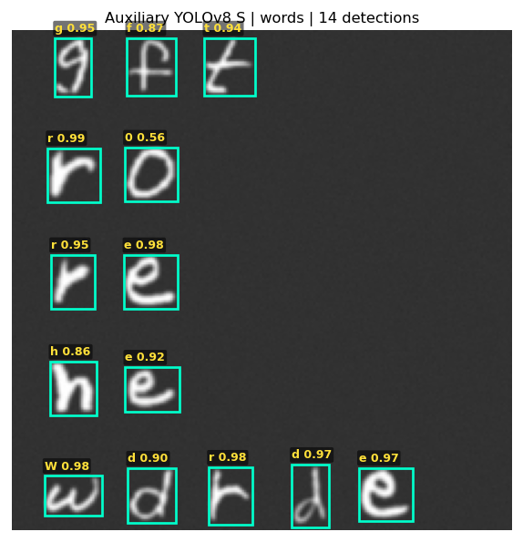 | 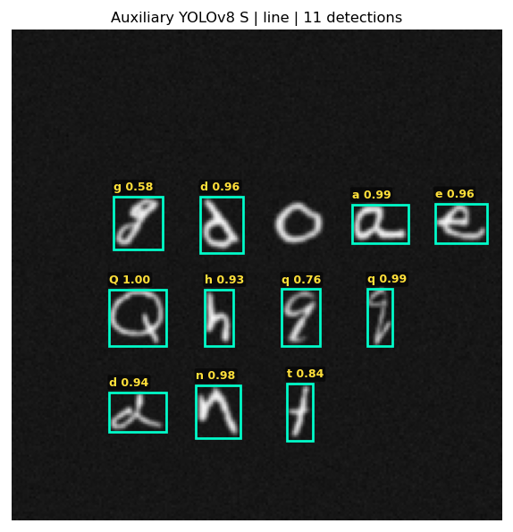 |
|  | 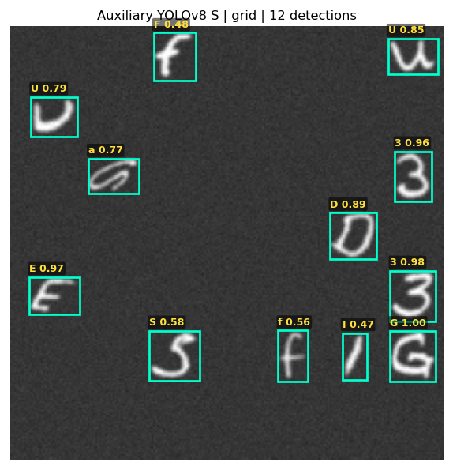 | 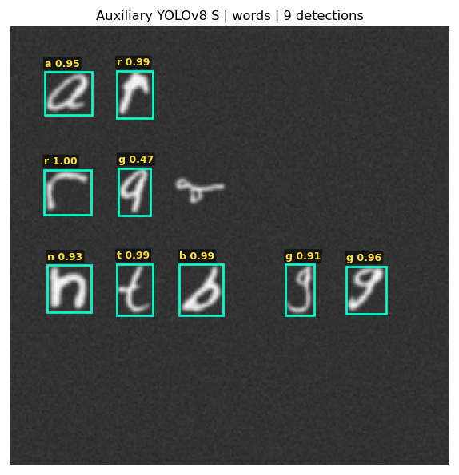 |  |
<!-- END GENERATED: visuals -->

## Reproduction

Use the project interpreter with CUDA, from the repository root:

```powershell
.venv1/Scripts/python.exe scripts/check_auxiliary_benchmark.py
Copy-Item checkpoint/auxiliary_n_28x14_best.pth weights/auxiliary_n_28x14_best.pth
Copy-Item checkpoint/auxiliary_s_28x14_best.pth weights/auxiliary_s_28x14_best.pth
.venv1/Scripts/python.exe scripts/run_single_stage_benchmark.py --detector auxiliary
.venv1/Scripts/python.exe scripts/run_density_sweep.py --detector auxiliary
.venv1/Scripts/python.exe scripts/generate_single_stage_visuals.py --detector auxiliary
.venv1/Scripts/python.exe scripts/render_benchmark_reports.py --auxiliary-only
.venv1/Scripts/python.exe scripts/check_auxiliary_benchmark.py --artifacts-only
```

Raw artifacts: [metrics and full held-out threshold sweep](auxiliary_results.json), [density sweep](auxiliary_density_sweep_results.json). Checkpoint hashes identify the precise weights evaluated. Existing baseline JSON files and notebook results are preserved.
