# YOLOv10-Style Detection: Accuracy and Throughput Without NMS

Benchmark of the completed Nano, Small and Medium runs, measured on 2026-10-20. Training uses one-to-one supervision for the main branch and one-to-many supervision for a smaller auxiliary neck/head. Inference retains only the main backbone, neck and 1:1 head.

This is the repository's YOLOv10-style dual-assignment detector, not the full published YOLOv10 architecture. It retains the existing C2f/SPPF/PAN body and direct four-distance LTRB regression, without CIB, PSA or distributional regression. The main branch detaches shared backbone features during training; the auxiliary branch trains the shared backbone.

The reported thresholds and scores are provisional: the held-out E2E sweep tested confidence 0.20–0.80 and excluded 0.10. The notebook's detection-only sweep selected 0.10 on its own split. A lower-threshold held-out comparison of detection F1 and E2E F1 remains pending.

## Evaluation Protocol

The benchmark uses the existing 10,000 test images: 2,500 each for `random`, `grid`, `words` and `line`. Inputs are 224 × 224 grayscale, scaled to [0, 1], evaluated in float32 on CUDA with batch 128. The 28 × 28 and 14 × 14 heads yield 980 candidate locations per image. Each location contributes its highest sigmoid class score; selected predictions are confidence-filtered and capped at 300 per image by score. **No NMS or IoU-based suppression is applied.**

Main metrics use one-to-one Hungarian geometric matching at IoU ≥ 0.50. Classifier accuracy is correct classes divided by geometrically matched detections. E2E F1 requires both a geometric match and the correct class. Detection and E2E TP/FP/FN can be reconstructed from the saved TP, ground-truth and prediction counts. Summary values are unweighted means across the four layouts.

## Summary

<!-- BEGIN GENERATED: summary -->
| Architecture | Size | Params | `conf` | `conf` Source | Avg Det Precision | Avg Det Recall | Avg Classifier Acc | Avg End-to-End F1 | Eval-Loop Throughput | Pure Inference |
|:---|:---:|:---:|:---:|:---:|:---:|:---:|:---:|:---:|:---:|:---:|
| **YOLOv10-style NMS-free** | Nano (`n`) | 0.83M | 0.50 | held-out tune set | 0.9999 | 0.9624 | 92.80% | 0.9101 | 478 img/s | 10,176 img/s |
| **YOLOv10-style NMS-free** | Small (`s`) | 2.51M | 0.45 | held-out tune set | 0.9996 | 0.9808 | 91.35% | 0.9045 | 587 img/s | 4,698 img/s |
| **YOLOv10-style NMS-free** | Medium (`m`) | 6.47M | 0.45 | held-out tune set | 0.9997 | 0.9831 | 90.27% | 0.8949 | 459 img/s | 2,345 img/s |
<!-- END GENERATED: summary -->

## Confidence Selection Before Final Evaluation

<!-- BEGIN GENERATED: tuning -->
Confidence thresholds for YOLOv10-style are tuned to maximize end-to-end F1 on a **held-out tuning set** (`data/OD_benchmark/tune/random`, 500 images from `scripts/generate_benchmark_dataset.py --tune-only`) that shares no images with the 10,000-image benchmark.

The unchanged benchmark sweep tests confidence 0.20–0.80 in 0.05 steps. Selection maximizes E2E F1; ties choose the lower threshold. Final four-layout evaluation uses the selected threshold; the full sweep and final metrics are saved together. This differs from notebook detection-only threshold selection.

These thresholds are best only within the tested 0.20–0.80 range. Confidence 0.10 was not evaluated in this held-out sweep. The notebook sweep selected 0.10 for class-agnostic detection F1 on its own evaluation split, which does not establish the best held-out E2E threshold. An expanded lower-threshold audit reporting both detection F1 and E2E F1 remains pending; the current threshold selections are provisional.

| Size | Selected confidence | Held-out E2E F1 |
|:---|:---:|:---:|
| Nano | 0.50 | 0.900299 |
| Small | 0.45 | 0.899910 |
| Medium | 0.45 | 0.894770 |
<!-- END GENERATED: tuning -->

## Checkpoints and Training Provenance

The best checkpoint from each completed run is copied unchanged into `weights/`. Best validation epochs below reflect the training logger's E2E metric; benchmark threshold selection is performed separately on the held-out tuning split.

<!-- BEGIN GENERATED: params -->
| Size | Training parameters | Main-only parameters | Best checkpoint | SHA-256 |
|:---|:---:|:---:|:---|:---|
| Nano | 1,084,096 | 831,608 | `weights\yolov10_n_28x14_best.pth` | `1686527edeb35f8d23e783fb50eadb7afc559a5ac8e89d7498272684b70fae05` |
| Small | 3,133,552 | 2,509,576 | `weights\yolov10_s_28x14_best.pth` | `f4376489028052875df5f11e22f99b71b6d47182edbefd69c32716399b177946` |
| Medium | 7,543,104 | 6,472,536 | `weights\yolov10_m_28x14_best.pth` | `9266ef449fb93f64a6e52381cc5417b1ea2501477ebc751d25caccaff8126489` |

All checkpoints load strictly. CUDA checks verified exact predictions before and after `to_inference()` removes the auxiliary network; decoding also passed with both NMS functions patched to raise if called.

| Size | Completed epochs | Best validation epoch | Best validation E2E F1 | Training time | Log |
|:---|:---:|:---:|:---:|:---:|:---|
| Nano | 60 | 55 | 0.9173 | 262.6 min | `logs/YOLOv10StyleObjectDetector/yolov10_n_28x14_20261018_122440.json` |
| Small | 60 | 46 | 0.9235 | 275.9 min | `logs/YOLOv10StyleObjectDetector/yolov10_s_28x14_20261019_075822.json` |
| Medium | 60 | 54 | 0.9427 | 373.4 min | `logs/YOLOv10StyleObjectDetector/yolov10_m_28x14_20261019_131547.json` |
<!-- END GENERATED: params -->

## Per-Layout Results

<!-- BEGIN GENERATED: results -->
### YOLOv10-style Nano

| Layout | Det Precision | Det Recall | Classifier Acc | End-to-End F1 | Eval-Loop Throughput |
|:---|:---:|:---:|:---:|:---:|:---:|
| 🎲 Random | 1.0000 | 0.9512 | 92.23% | 0.8992 | 465.4 img/s |
| 📐 Grid | 0.9998 | 0.9491 | 92.39% | 0.8997 | 480.6 img/s |
| 📝 Words | 0.9997 | 0.9748 | 93.18% | 0.9198 | 496.1 img/s |
| 📏 Line | 0.9999 | 0.9743 | 93.39% | 0.9217 | 469.8 img/s |
| **Average** | **0.9999** | **0.9624** | **92.80%** | **0.9101** | **478.0 img/s** |

Pure inference (`model(images)` only, batch 128): **10,176.3 img/s**.

### YOLOv10-style Small

| Layout | Det Precision | Det Recall | Classifier Acc | End-to-End F1 | Eval-Loop Throughput |
|:---|:---:|:---:|:---:|:---:|:---:|
| 🎲 Random | 0.9998 | 0.9765 | 90.58% | 0.8950 | 600.1 img/s |
| 📐 Grid | 0.9995 | 0.9733 | 91.05% | 0.8979 | 586.6 img/s |
| 📝 Words | 0.9996 | 0.9869 | 91.88% | 0.9126 | 574.8 img/s |
| 📏 Line | 0.9997 | 0.9864 | 91.89% | 0.9125 | 586.1 img/s |
| **Average** | **0.9996** | **0.9808** | **91.35%** | **0.9045** | **586.9 img/s** |

Pure inference (`model(images)` only, batch 128): **4,698.1 img/s**.

### YOLOv10-style Medium

| Layout | Det Precision | Det Recall | Classifier Acc | End-to-End F1 | Eval-Loop Throughput |
|:---|:---:|:---:|:---:|:---:|:---:|
| 🎲 Random | 0.9996 | 0.9794 | 90.12% | 0.8916 | 532.0 img/s |
| 📐 Grid | 0.9997 | 0.9771 | 90.80% | 0.8974 | 502.9 img/s |
| 📝 Words | 0.9998 | 0.9880 | 90.20% | 0.8965 | 532.2 img/s |
| 📏 Line | 0.9998 | 0.9880 | 89.95% | 0.8940 | 267.6 img/s |
| **Average** | **0.9997** | **0.9831** | **90.27%** | **0.8949** | **458.7 img/s** |

Pure inference (`model(images)` only, batch 128): **2,344.7 img/s**.
<!-- END GENERATED: results -->

## Throughput

<!-- BEGIN GENERATED: throughput -->
| Size | Median pure inference | Repeat range | Eval-loop average |
|:---|:---:|:---:|:---:|
| Nano | 10,176.3 img/s | 9,807.4–10,959.2 | 478.0 img/s |
| Small | 4,698.1 img/s | 4,412.4–4,953.1 | 586.9 img/s |
| Medium | 2,344.7 img/s | 2,216.0–2,359.1 | 458.7 img/s |

Measured on NVIDIA GeForce RTX 5070 Ti, PyTorch 2.11.0+cu130, float32, batch 128. Pure inference uses GPU-resident real images, at least 2 seconds of warm-up, and 11 repeats of 30 forward passes synchronized around each repeat. It excludes transfers, decoding, score filtering/top-k and matching. It therefore does not measure savings from removing NMS.

Eval-loop throughput includes PNG loading, target collation, transfers, NMS-free decoding and Hungarian matching. It varies with CPU and I/O overhead and is not a model-only speed measure. Historical baseline throughput was measured in different sessions.
<!-- END GENERATED: throughput -->

## Recall by Object Density

This uses the repository's existing score-ordered greedy matcher at IoU 0.50, with unique ground-truth matches. The main E2E table uses Hungarian matching. Buckets cover 1–16 ground-truth objects; images outside that range remain in the main evaluation. These separate matching protocols are preserved for historical comparability.

<!-- BEGIN GENERATED: density -->
### 🎲 Random Layout

| Density Bucket ($n_{gt}$) | Test Images | YOLOv10-style Nano | YOLOv10-style Small | YOLOv10-style Medium |
|:---:|:---:|:---:|:---:|:---:|
| **1 – 4 objects** | 236 | 95.3% | 97.5% | **98.0%** |
| **5 – 8 objects** | 1,244 | 94.8% | 97.5% | **97.8%** |
| **9 – 12 objects** | 850 | 95.3% | 97.7% | **98.0%** |
| **13 – 16 objects** | 170 | 95.5% | 97.9% | **98.1%** |

### 📐 Grid Layout

| Density Bucket ($n_{gt}$) | Test Images | YOLOv10-style Nano | YOLOv10-style Small | YOLOv10-style Medium |
|:---:|:---:|:---:|:---:|:---:|
| **1 – 4 objects** | 228 | 94.4% | 97.0% | **97.5%** |
| **5 – 8 objects** | 1,319 | 95.0% | 97.5% | **97.6%** |
| **9 – 12 objects** | 807 | 95.2% | 97.2% | **97.8%** |
| **13 – 16 objects** | 146 | 93.7% | 97.1% | **97.7%** |

### 📝 Words Layout

| Density Bucket ($n_{gt}$) | Test Images | YOLOv10-style Nano | YOLOv10-style Small | YOLOv10-style Medium |
|:---:|:---:|:---:|:---:|:---:|
| **1 – 4 objects** | 253 | 97.7% | 98.8% | **98.9%** |
| **5 – 8 objects** | 1,235 | 97.5% | 98.6% | **99.0%** |
| **9 – 12 objects** | 866 | 97.4% | **98.8%** | 98.7% |
| **13 – 16 objects** | 137 | 97.5% | **98.7%** | 98.6% |

### 📏 Line Layout

| Density Bucket ($n_{gt}$) | Test Images | YOLOv10-style Nano | YOLOv10-style Small | YOLOv10-style Medium |
|:---:|:---:|:---:|:---:|:---:|
| **1 – 4 objects** | 244 | 96.7% | **99.1%** | 98.7% |
| **5 – 8 objects** | 1,231 | 97.2% | 98.6% | **99.0%** |
| **9 – 12 objects** | 862 | 97.7% | 98.6% | **98.7%** |
| **13 – 16 objects** | 149 | 97.5% | 98.6% | **98.7%** |
<!-- END GENERATED: density -->

## Comparison with Existing Detectors

<!-- BEGIN GENERATED: comparison -->
| Size | YOLOv8 E2E F1 | Auxiliary YOLOv8 E2E F1 | YOLOv10-style E2E F1 | Change vs YOLOv8 | Change vs Auxiliary |
|:---|:---:|:---:|:---:|:---:|:---:|
| Nano | 0.9087 | 0.9071 | 0.9101 | +0.14 pp | +0.30 pp |
| Small | 0.9061 | 0.9065 | 0.9045 | -0.16 pp | -0.20 pp |
| Medium | 0.8990 | not trained | 0.8949 | -0.41 pp | — |

These compare single trained runs and historical checkpoints. They do not isolate the causal effect of assignment, loss, detachment or auxiliary supervision; no repeated-seed uncertainty estimate is available. YOLOv8 Medium retains its documented test-sweep threshold override; YOLOv10-style thresholds are all selected on held-out data.
<!-- END GENERATED: comparison -->

Nano achieved the highest E2E F1 of the three YOLOv10-style sizes (0.9101) and the highest model-only throughput (10,176.3 img/s). Scaling to Small increased recall from 96.24% to 98.08%, but conditional classification accuracy fell from 92.80% to 91.35%; Medium reached 98.31% recall with 90.27% conditional classification accuracy. E2E F1 consequently fell to 0.9045 and 0.8949. Conditional accuracy is measured on each model's own matched detections, so this does not establish that larger models classify the same objects less accurately.

YOLOv10-style Nano exceeded the existing YOLOv8 Nano by 0.14 percentage points and auxiliary YOLOv8 Nano by 0.30 percentage points in E2E F1. Those small differences from single runs do not establish a reliable accuracy gain. The demonstrated deployment result is an NMS-free 1:1 detector with competitive E2E accuracy; Nano is the strongest practical choice among these measured sizes. Model-only throughput excludes post-processing, so these timings cannot quantify the benefit of removing NMS.

## Visual Examples

These use the same exported head, selected confidence and score top-k as the benchmark, without NMS or an extra class-confidence gate.

<!-- BEGIN GENERATED: visuals -->
### Nano

| Random | Grid | Words | Line |
|:---:|:---:|:---:|:---:|
| 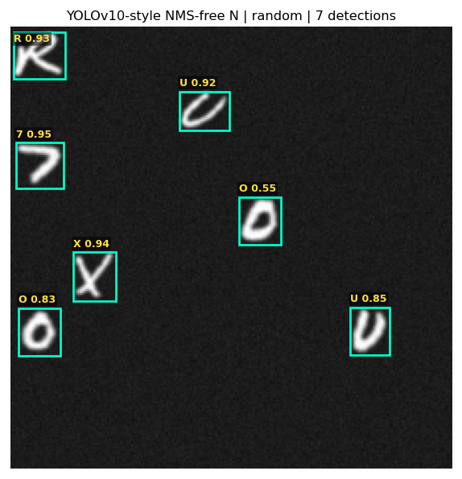 | 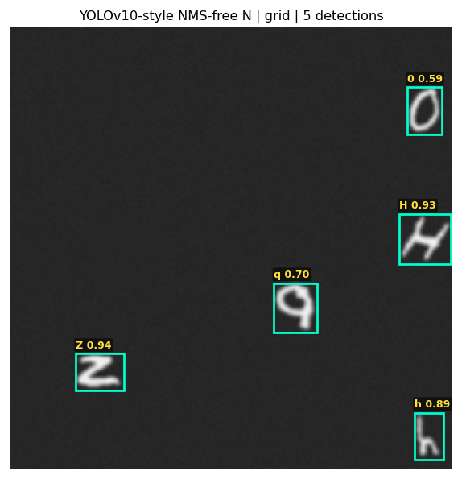 |  | 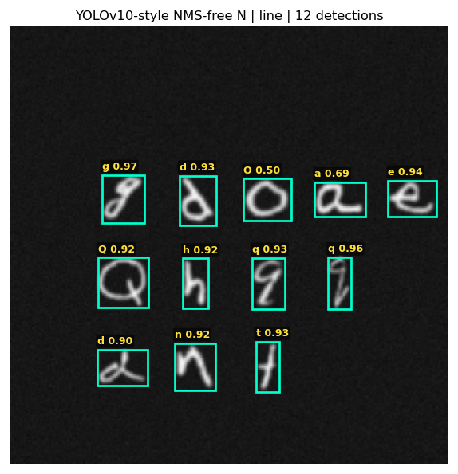 |
| 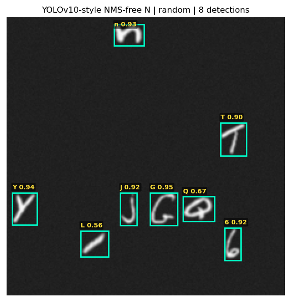 | 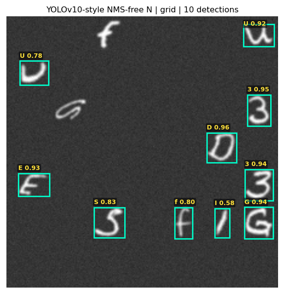 | 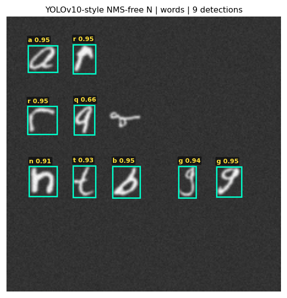 | 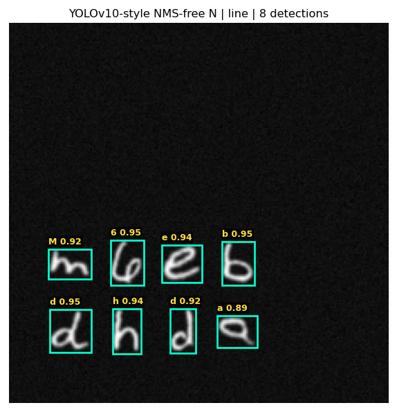 |

### Small

| Random | Grid | Words | Line |
|:---:|:---:|:---:|:---:|
|  | 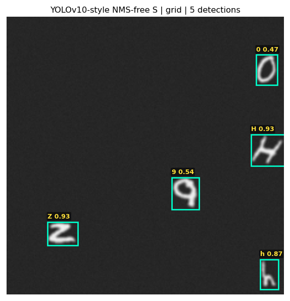 | 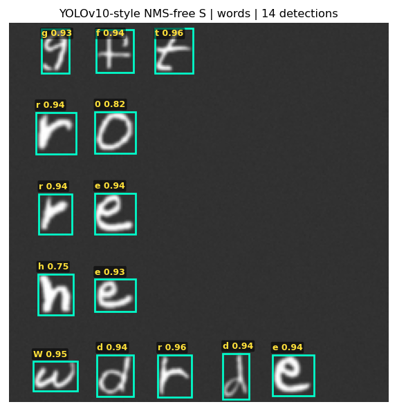 | 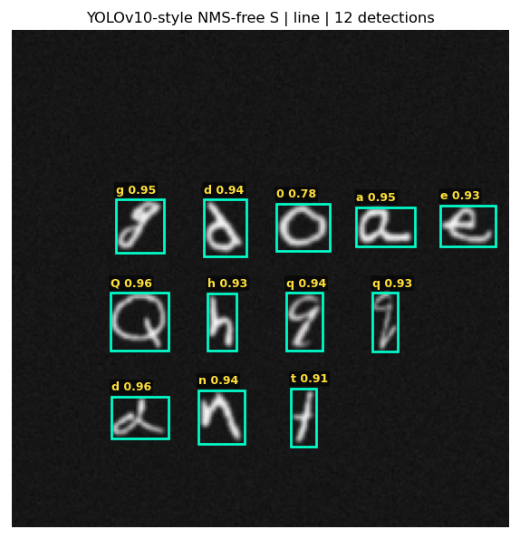 |
|  | 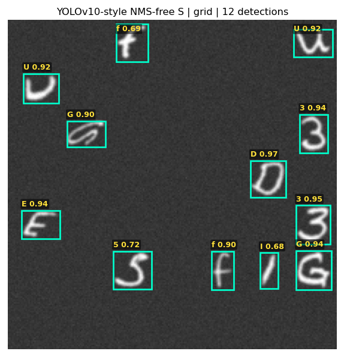 | 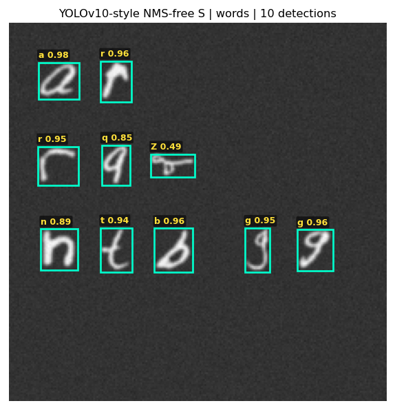 |  |

### Medium

| Random | Grid | Words | Line |
|:---:|:---:|:---:|:---:|
| 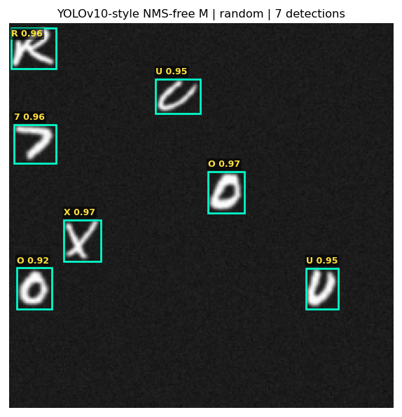 | 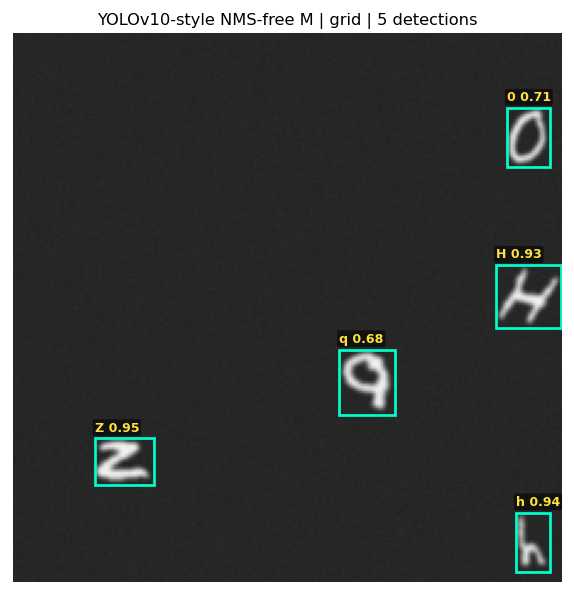 |  |  |
| 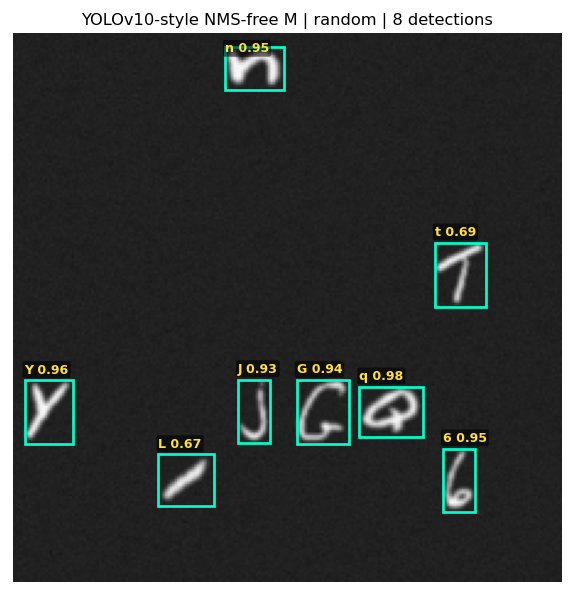 | 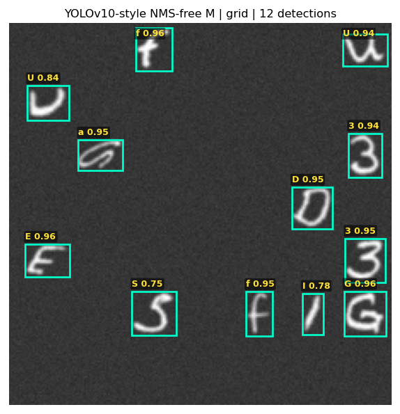 |  |  |
<!-- END GENERATED: visuals -->

## Reproduction

Run from the repository root using the configured CUDA interpreter:

```powershell
.venv1/Scripts/python.exe scripts/check_yolov10_benchmark.py
.venv1/Scripts/python.exe scripts/run_single_stage_benchmark.py --detector yolov10
.venv1/Scripts/python.exe scripts/run_density_sweep.py --detector yolov10
.venv1/Scripts/python.exe scripts/generate_single_stage_visuals.py --detector yolov10
.venv1/Scripts/python.exe scripts/render_benchmark_reports.py --yolov10-only
.venv1/Scripts/python.exe scripts/check_yolov10_benchmark.py --artifacts-only
```

Raw artifacts: [metrics and held-out threshold sweeps](yolov10_results.json), [density sweep](yolov10_density_sweep_results.json), and [checkpoint/export provenance](yolov10_provenance.json). The provenance file records hashes of protected baseline artifacts and the notebook so preservation can be checked after the benchmark.
